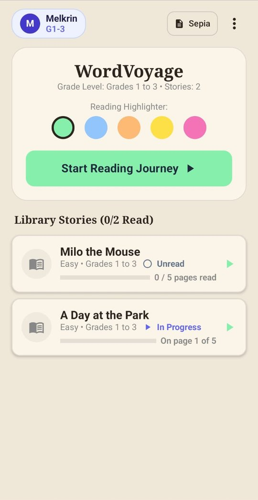
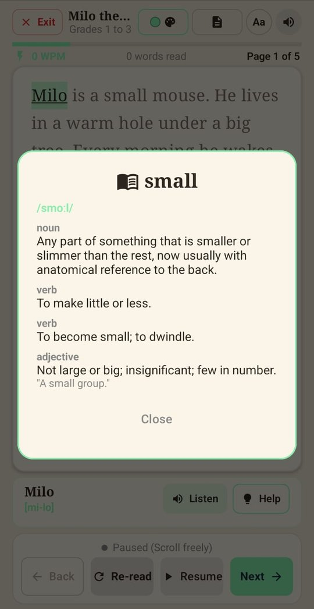
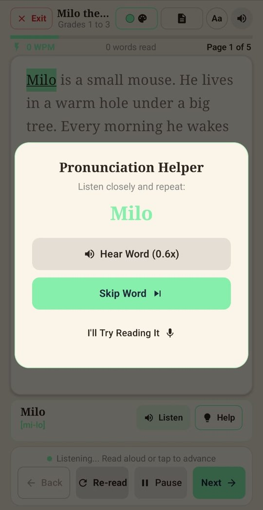
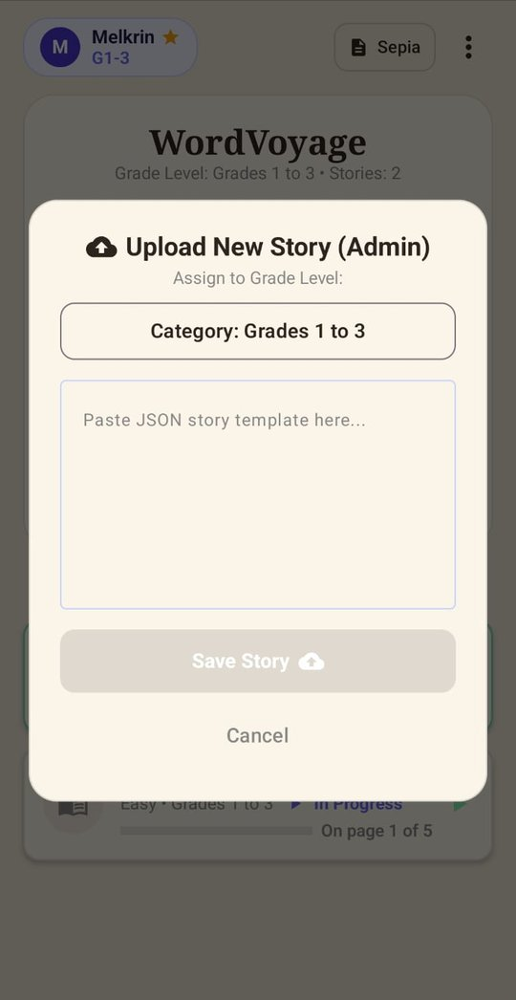

# WordVoyage (Firestore Edition) ☁️📖


**This is the cloud-managed version of [WordVoyage](https://github.com/Lourdusmel-16/WordVoyage), an Android reading app that helps children read aloud, one word at a time.**
Stories are stored in **Cloud Firestore**, so you can add, edit or remove them at any time and every installed app updates without a new release.

It listens to the child, highlights each word as it is read, offers help when the child gets stuck, and finishes every story with a short comprehension check.

<p align="center">
  
  
  
  
</p>

> 🔀 Prefer an offline app where the stories ship inside the APK?
> Use the **[JSON version →](https://github.com/Lourdusmel-16/WordVoyage)**

---

## ✨ Features

| | |
|---|---|
| 🎯 **Word-by-word reading** | The highlight follows the child's voice using on-device speech recognition (Sherpa-ONNX). Tapping also moves on. |
| 📚 **Four grade levels** | Grades 1–3, 4–5, 6–8 and 9–12, each with its own stories. |
| 🔍 **Long-press for meaning** | Press and hold any word to see its dictionary meaning. Reading pauses while the box is open. |
| 🆘 **Smart help popup** | After **6 seconds** on one word, a friendly "Need a hand?" box appears, leading to a Pronunciation Helper (slow 0.6x playback, skip, or try again). |
| 🔊 **Read aloud** | Text-to-speech can read the page to the child. |
| 📝 **Comprehension check** | A short multiple-choice question after every story, with live stats: words spoken, fluency (WPM) and reading time. |
| 🎉 **Celebration screen** | A "Chapter Complete!" reward after each story. |
| 📊 **Reader dashboard** | Change username and grade, see read stories, reset progress, or log out. Progress is saved per user in Firebase. |
| 🎨 **Reader settings** | Dyslexia-friendly font, text size, Sepia / Day / Night pages and five highlight colours. |
| 🛠️ **Admin upload** | Admins paste a story's JSON into the app, pick a grade level and upload it straight to Firestore. |
| 🧭 **Interactive guide** | A 7-step first-time tour with try-it boxes. Re-open it any time from **Re-explain Stories**. |

## 📸 Screenshots

<table align="center">
  <tr>
    <td align="center" width="20%"><br><sub><b>Home library</b></sub></td>
    <td align="center" width="20%"><br><sub><b>Reading</b></sub></td>
    <td align="center" width="20%"><br><sub><b>Long-press meaning</b></sub></td>
    <td align="center" width="20%"><br><sub><b>Help after 6 s</b></sub></td>
    <td align="center" width="20%"><br><sub><b>Pronunciation helper</b></sub></td>
  </tr>
  <tr>
    <td align="center"><br><sub><b>Interactive guide</b></sub></td>
    <td align="center"><br><sub><b>Menu</b></sub></td>
    <td align="center"><br><sub><b>Reader dashboard</b></sub></td>
    <td align="center"><br><sub><b>Chapter complete</b></sub></td>
    <td align="center"><br><sub><b>Comprehension check</b></sub></td>
  </tr>
  <tr>
    <td align="center"><br><sub><b>Admin story upload</b></sub></td>
    <td></td><td></td><td></td><td></td>
  </tr>
</table>

---

## ☁️ Why the Firestore version?

- **Live content updates:** add a story in Firebase and every user sees it right away.
- **Admin upload for everyone:** an admin pastes a story's JSON into the app, taps **Upload to Firestore**, and it is saved to the cloud, not just to one device.
- **No rebuilds or app updates** for typo fixes, new stories or re-ordering.
- **Small APK:** the story library does not grow the app size.
- **Single source of truth:** all devices always show the same stories.

**Trade-offs**
- Stories need an internet connection to load.
- Story reads count toward your Firestore quota (the free tier is generous for small apps).
- You need to publish Firestore security rules (see [docs/SETUP.md](docs/SETUP.md)).

👉 Want an offline app with stories bundled inside? **[Open the JSON version →](https://github.com/Lourdusmel-16/WordVoyage)**

---

## 🧠 How it works

```
 ┌─────────────────────────┐
 │  Firestore: stories/    │  ← story library (this version)
 └────────────┬────────────┘
              ▼
 Child ──► Reading screen ──► Speech recognition + text-to-speech
              │
              ▼
 ┌─────────────────────────┐
 │  Firebase               │  Authentication (sign-in)
 │  users/{uid}            │  + Firestore (progress, admin flag)
 └─────────────────────────┘
```

- On sign-in the app fetches the `stories` documents that match the child's grade level.
- **Accounts and progress** live in Firebase, keyed by each story's document ID.
- **Admin passcode** is not in the code or the APK. It is stored in a private Firestore document and checked by Firestore security rules.
- **Word meanings** come from the free [dictionaryapi.dev](https://dictionaryapi.dev) service and need internet.

### Firestore data model

**`stories`**: one document per story. The document ID is the story's permanent ID; never rename it.

```json
{
  "title": "The Little Fox",
  "gradeLevel": "Grades 1 to 3",
  "ageGroup": "GRADES_1_3",
  "difficulty": "Easy",
  "order": 1,
  "screens": ["Page one text.", "Page two text."],
  "quiz": {
    "question": "What did the fox find?",
    "options": ["A key", "A lantern", "A map"],
    "correctIndex": 1
  }
}
```

`ageGroup` must be `GRADES_1_3`, `GRADES_4_5`, `GRADES_6_8` or `GRADES_9_12`.

| Collection | Purpose |
|---|---|
| `users/{uid}` | Profile, grade level, reading progress, admin flag |
| `config/admin` | Private document holding the admin passcode (`code` field) |
| `adminClaims/{uid}` | Created when someone enters the passcode; rules verify it |

### Adding stories
- **From the app (admin):** sign in as admin, tap **Upload New Story (Admin)**, choose the grade level, paste the story JSON, and tap **Upload to Firestore**.
- **From the Firebase console:** add a document to the `stories` collection with the fields above.

---

## 🚀 Getting started

Full, step-by-step instructions are in **[docs/SETUP.md](docs/SETUP.md)**. In short:

1. Clone this repo and open it in Android Studio.
2. Create a Firebase project, enable **Email/Password** sign-in and **Firestore**.
3. Put your own `google-services.json` in `app/` (it is git-ignored on purpose).
4. Create the admin passcode document and publish the security rules (they include the `stories` rules).
5. Add some stories (from the app as admin, or in the Firebase console).
6. Add the speech-recognition model files to `app/src/main/assets/sherpa-model/`.
7. Run on a real Android device and allow the microphone.

---

## 🗂️ Project structure

```
app/src/main/
├── assets/
│   └── sherpa-model/              # speech model (you add this, see docs/SETUP.md)
└── java/com/sample/readingapp/
    ├── MainActivity.kt
    ├── data/        # Story, AgeGroup, StoryRepository (Firestore), StorySeeder, word meanings
    ├── speech/      # Sherpa speech recognition, text-to-speech
    ├── theme/       # colours, fonts, reader themes
    ├── util/        # text helpers, app config
    └── ui/
        ├── auth/        # sign-in and sign-up
        ├── intro/       # splash and welcome
        ├── home/        # grade and story list, admin upload
        ├── reader/      # reading screen, guide, quiz, celebration
        └── components/  # dialogs and shared widgets
```

## 🛠️ Tech stack

Kotlin · Jetpack Compose · Material 3 · Firebase Authentication · Cloud Firestore · Sherpa-ONNX (speech recognition) · Android TextToSpeech · Gson · JUnit · GitHub Actions

## 🗺️ Roadmap

- [ ] Edit and delete stories from the admin screen
- [ ] More stories per grade level
- [ ] Reading-speed and accuracy reports for teachers
- [ ] More languages

## 🔗 Related

- **[WordVoyage (JSON version)](https://github.com/Lourdusmel-16/WordVoyage)**: stories bundled in the app, fully offline.

## 🤝 Contributing

Suggestions and pull requests are welcome. Please open an issue first to discuss big changes.

## 📄 License

Released under the MIT License. See [LICENSE](LICENSE).

## 👤 Author

**Lourdus Rogin Melkrin S**
[GitHub](https://github.com/Lourdusmel-16) · [LinkedIn](https://www.linkedin.com/in/lourdus-rogin-melkrin-s)
